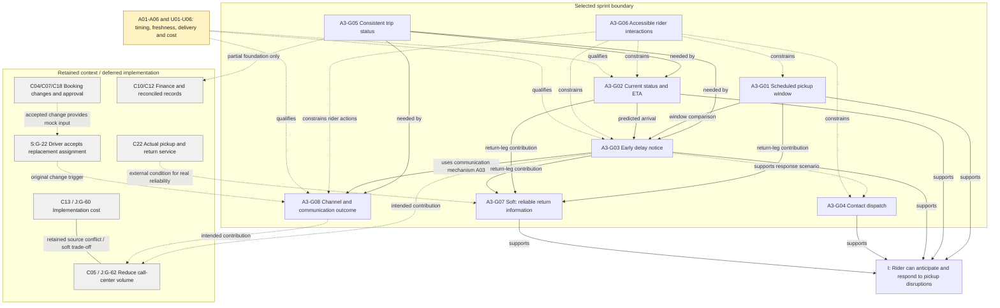
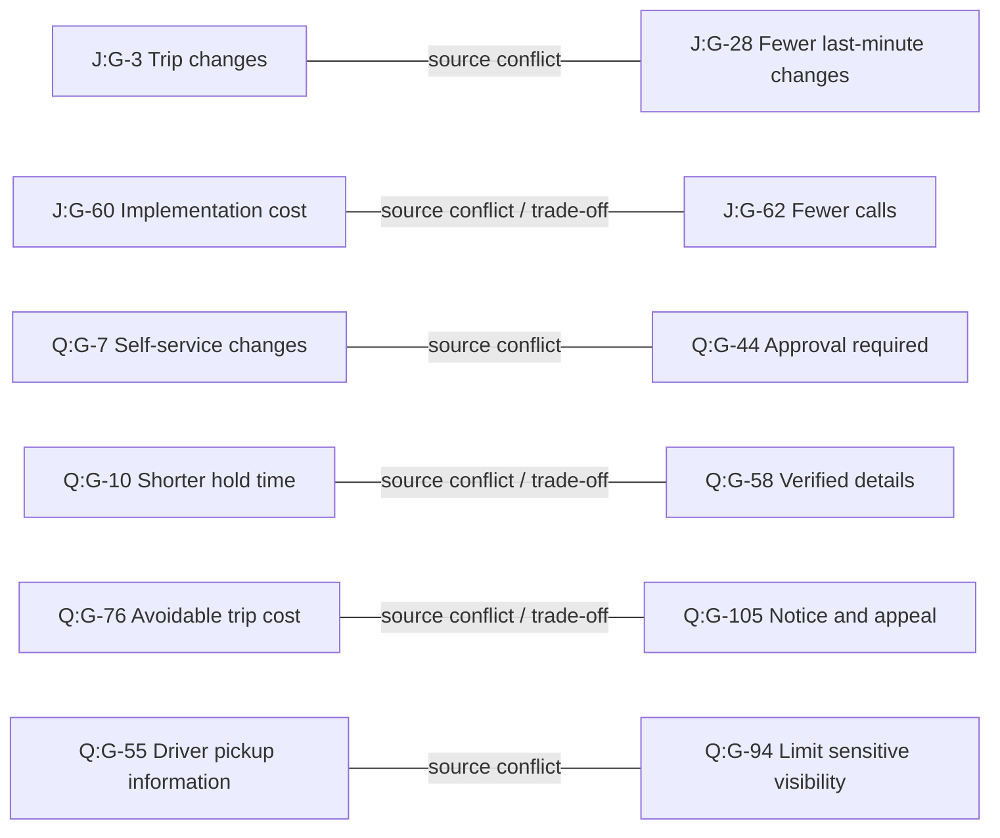

# A3 Goal Model and Decisions - Step 1 / Step 2

范围：**Trip Status, ETA and Delay Communication（行程状态、ETA 与延误沟通）**。

状态：本轮 Step 1、2 技术产物。模型选择、协调与关系分析已完成；未进行 stakeholder 追加确认、Spec Kit 开发或原型评估。以下“决定”是可审核的技术建模决定，不表示组员已共同批准，也不是本人 Learning Log。

## 1. 输入、编号与证据规则

### 1.1 本次实际审查的文件

| 前缀 | 本次指定的 ZIP | combined 模型目标数 | 实际检查范围 |
| --- | --- | --- | --- |
| S | `HW2_shuxinl2.zip` | 39 | combined + Janelle / Frank / Diane 三份 individual Python 模型；`missing.json`；Mermaid 输出 |
| J | `HW2_jiashend.zip` | 81 | 同上四份 Python 模型；individual/combined 的来源与 Derived 标记、模型内冲突和合并说明 |
| Q | `hw2(1).zip` | 90 | 同上四份 Python 模型；`missing.json`、NOT_IN_TRANSCRIPT、模型内冲突和合并说明；docstring 标明 Qingyuan Yao |

共检查 12 份 Python 模型，combined 层共有 **210 个目标**。这是原文件定义数，不能解释为 210 个不同业务需求，也不用于质量排名。未读取各人的 reflection 作为需求证据。

`S:G-17`、`J:G-17`、`Q:G-17` 是不同节点。A3 新 ID 不替换原 ID；跨人引用必须带前缀。原文件保存在 `sources/S|J|Q/`；`source-crosswalk.csv` 提供原 ID、名称、类型、文件、行号与整合主题。

同时检查 individual 模型中在 combined 中不再单列的 ID：保留 **24 个退役 goal ID 的别名映射**，另保留 **4 个 individual DomainProperty**。例如 S:G-16 合入 S:G-4；J:G-44/G-68 合入 J:G-17；Q:G-65 合入 Q:G-4。完整别名表见附录 B。Q:DP-4 在原 combined 中合入 Q:DP-1；DP-1 的 combined 定义也有改写，原表达式保留在 JSON，未抹去此差异。

### 1.2 已实际核对的原始访谈

以下均为 Shuxin 本人 HW1 原始 CSV，随包保存在 `sources/evidence/`：

| 证据代号 | 文件 | 行号约定 |
| --- | --- | --- |
| SJ | `transcript-261028-0806.csv`，Janelle | CSV 记录号，表头为第 1 行 |
| SF | `transcript-261028-0806 (1).csv`，Frank | 同上 |
| SD | `transcript-261028-0806 (2).csv`，Diane | 同上 |

原模型注释中的旧 row 编号有时排除了表头或合并了访谈片段；本文统一重新读取 CSV 计算，不直接复用旧 row 数。

Jiashen 与 Qingyuan 的原始 HW1 transcript 不在三个 ZIP 中。他们的时间戳、Tn 与引文在此属于 **模型附带来源信息，尚未独立检查原始 transcript**。本轮所选 8 个目标都能在上述本人原始访谈找到支持；其他组员独有的细节被保留为补充、推导或待澄清，不能因为多人模型出现就变成已验证事实。

### 1.3 证据分层

- **E - checked evidence**：实际读到的 stakeholder 原话，记录 CSV、行、时间戳。
- **M - source-model detail**：原模型所载细节或原模型关系，未必有本轮可核验的原始访谈。
- **I - analyst inference**：原模型明确 Derived / INFERRED / NOT_IN_TRANSCRIPT，或本轮对界面、数据、关系的建模解释。
- **A - prototype assumption**：为模拟原型选定的操作方式；可以在 Step 3 明写进 spec，但不得改称 stakeholder 确认。

S 的 `missing.json` 中 goals 为空，但 Python 名称仍明确把 G-34..39、G-41 标为 INFERRED，不能据空数组断言所有目标均来自原话。Q 的 `missing.json` 与 NOT_IN_TRANSCRIPT 集合也不完全一致：如 Q:G-50/G-59/G-80 已在 combined 中被合并。保留原文件，并按具体表达式、注释和证据判断，不能仅依赖一个标记文件。

## 2. Step 1 - 整合与差异协调

### 2.1 整合模型的表达方式

本模型采用两层整合：

1. **保留来源层**：210 个 combined goals 的含义、类型与原始细化表达式保留，另保留 individual 版本与退役别名。源模型的 ConflictLink、ObstructionLink、ResolutionLink 也保留在 `goal-model.json`，而非只复制一张图。
2. **A3 决策层**：将来源目标组织进 31 个主题，其中 8 个为本轮所选目标，23 个为背景或暂缓主题。将语义重叠部分协调为新的明确范围；将较大目标中的未实现部分继续留在背景层。主题归属本身只表示组织关系，**不表示其中每个原目标彼此等价或已被完整实现**。

例如 Q:G-89 同时要求 manifest、MDT 与 financial reports 的传播。A3-G05 只取其中“共享行程状态一致”的部分，不能声称已实现完整 Q:G-89。J:G-19 的“一分钟重算 ETA”保留在来源层，但未提升为 A3 统一要求。原模型的 complete=True 仍是原作者的断言，不是本轮对细化充分性的认证。

模型格式由 Markdown + Mermaid + JSON 共同表达。A3 PDF 没有规定必须使用 `goalmodeling` 或 Python，因此不另造一套必须运行的 Python 框架。JSON 保留全部原始 goal/refinement/performance 表达式及 source links，便于需要时继续转换。

### 2.2 跨模型差异的具体处理

| 编号 | 原始差异与来源 | 协调结果 | 证据身份与保留方式 |
| --- | --- | --- | --- |
| M01 | S:G-7 是 scheduled pickup window；S:G-8 / Q:G-23 / J:G-20 是动态 ETA | 窗口和 ETA 分别保留为 G01、G02；禁止用新 ETA 覆盖原承诺窗口 | SJ 第 31 行直接区分两种信息；两个目标都在范围内 |
| M02 | J:G-19 固定每分钟从 GPS 重算；S:G-8 未规定频率；Q:G-24/G-25 采用位置上报与计算 | 合并“可见的最新状态/ETA”这一共同目标。GPS、交通计算与一分钟 SLA 作为来源模型细化保留，原型使用模拟更新 | J 的 DERIVED_GOALS 包含 G-18/G-19；Q 将 G-24/G-25 标为 NOT_IN_TRANSCRIPT。频率未获 E 级支持 |
| M03 | S:G-9 要求窗口结束前通知；Q:G-26 用 predicted pickup 晚于 30-minute window 作触发；J:G-17 范围为 delay/status change | 将“判断将晚于窗口”与“何时发通知”分开处理；保留 G03 提前通知，窗口长度取每趟已保存值 | SJ 第 21、34 行支持提前通知；30 分钟不是从本人的访谈验证出的统一常数 |
| M04 | S:G-23 是操作用户间状态同步；J:G-32 细化为 manifest/block/assignment；Q:G-89 扩展至财务 | 统一共享状态接口；本轮只实现 rider/dispatcher 的同一模拟行程记录，完整 manifest/MDT/finance integration 延后 | SF 第 27、31、33 行支持一致性；延后部分仍保留其原 ID |
| M05 | S:G-22/G-24 描述司机接受变更后的偏好渠道和通知结果；J:G-17/Q:G-27 倾向“已发出通知” | 共享通知事件基础，但分别保留“生成/发送”“送达”“确认”“无法联系”；不把 sent 当成 acknowledged | SF 第 21、25、36 行支持；本轮包含模拟结果，真实渠道基础设施延后 |
| M06 | S:G-12 / Q:G-12 主要写 booking accessibility；S:G-31 是 customer-facing WCAG；J:G-23 将其用于整个 app | G06 约束本轮所有 rider controls，不因 booking 不在本轮就删除无障碍约束；保留 voice/switch 细节为 Q 来源项 | SD 第 25 行直接支持 WCAG 2.1 AA；将其落实到 status/notice/contact 是 I/A 级范围解释 |
| M07 | S:G-14 关注返程到达信息质量；Q:G-6 还包含实际接车准点、成对排程；J 的状态树未单列返程 | 将 G07 留为跨 G01/G02/G03 的信息质量目标，并包含返程模拟情景；不将“显示 ETA”合并成“车辆保证准点” | SJ 第 14、18、34 行；Q:G-41/G-42 保留在范围外实体服务层 |
| M08 | S:G-10 是 revised ETA 不合适时联系调度；Q:G-8 是宽泛 staff exceptions；J:G-14 是改程被拒的解释 | 只选联系/报告不合适，不把它改写为自动改程或保证接受新时间 | SJ 第 21 行直接支持；Q:G-8/J:G-14 为背景支持，非等价合并 |
| M09 | 三份模型对 AND/OR、父目标和冲突使用不同形式；S:G-41 有窗口/ETA 两条替代 refinement | 保留原树；A3 当前边界同时要求 G01、G02。新增整合根与贡献边均标 I，不继承“仅窗口就足够当前信息”的解释 | 不把树形结构相似当成细化的逻辑充分性证明 |

## 3. Step 1 - 选定 goals、边界与证据

### 3.1 边界

**输入**：预置的 outbound/return trips、各自已安排的 pickup window、模拟车辆状态与 ETA、偏好通知渠道、模拟通知结果。由 mock dispatcher 更新已存在行程的当前信息。

**系统内行为**：乘客查看已安排的窗口、状态与 ETA；发现延误风险时获得明确提醒；通过模拟联系入口报告 revised ETA 不合适；调度与乘客读取一致的状态；调度查看通知是否送达、确认或联系不上。所有 rider 交互具有本轮范围内的无障碍支持。

**系统外责任**：实际车辆运行、定位设备、司机接受调度、真实短信/电话/邮件送达、完整车辆分配与路线优化、财务结算。原型模拟这些输入或结果，不声称已经实现相应外部服务。司机接受的模拟标志是变更通知的前置输入，不等于本轮实现完整调度审批。

### 3.2 所选目标与前期 requirement 描述

此处是进入 Step 3 的输入，还不是 Spec Kit 生成的正式 spec。A3-Gxx 为稳定 goal ID；暂用 R-01..08 指代本轮 requirement 候选，Step 3 应保留其映射。

| A3 Goal / 类型 | Requirement 候选 | 主要原模型映射 | 已核对的访谈 |
| --- | --- | --- | --- |
| **G01 Achieve** | **R-01** Rider can view the scheduled pickup window for each selected trip leg. 将 scheduled window 与 ETA 分开展示，ETA 更新不改写原窗口。 | S:G-7、Q:G-22 语义对应；J:G-10 的 confirmation 只有窗口信息部分相关，完整 booking 不在范围 | SJ 第 31 行，2026-10-27T14:03:08.818Z：希望看到 scheduled pickup window、live status 与 updated ETA |
| **G02 Achieve / quality constraint** | **R-02** Rider can view current vehicle/trip status and the latest available ETA. 标注更新时间；没有可用估计时明确未知。具体 freshness 指标待定，原型只保证与最新模拟输入一致。 | S:G-8；J:G-4/G-15/G-16/G-20（保留其 G-18/G-19/G-21/G-22 细化的推导身份）；Q:G-4/G-23（G-24/G-25 是推导实现细节） | SJ 第 31、34 行；SJ 第 34 行时间 2026-10-27T14:04:06.720Z，优先可靠、准确的 pickup information |
| **G03 Achieve** | **R-03** When a pickup is predicted to miss its saved window, the rider receives a distinct delay notice containing the current ETA. 有机会时在原窗口结束前提醒；不能仅静默更新 ETA。晚发现情况见 D03。 | S:G-9；Q:G-26/G-27 的 delay/change 部分；J:G-17 的 delay 部分。较宽泛 status-change 通知不是全部默认选入 | SJ 第 18 行：此前没有通知；第 21 行，2026-10-27T14:00:39.816Z：要求窗口结束前更新，附当前 ETA |
| **G04 Achieve** | **R-04** Rider can contact dispatch or report that a revised ETA is unsuitable. 模拟联系入口不立即改变预约、窗口或车辆安排，也不保证调度接受请求。 | S:G-10 直接对应；Q:G-8 为更大的人工例外处理目标，仅作背景支持 | SJ 第 21 行；SJ 第 23 行还说明目前联系调度需等待 |
| **G05 Maintain** | **R-05** Rider and dispatcher views use a consistent trip-status record. 同一次模拟更新不能在两个视图留下互相矛盾的 ETA/通知状态。 | S:G-23；J:G-29/G-31/G-32..35；Q:G-89 仅状态传播部分，Q:G-88 的 finance 侧暂缓 | SF 第 27、31、33 行；第 31 行，2026-10-28T09:18:24.415Z：不同 screen 使用不同版本导致太晚才发现问题 |
| **G06 Maintain** | **R-06** Rider status, notice and contact interactions support independent accessible use, with scoped WCAG 2.1 AA as the target. 可操作性、标签、焦点、状态消息与对比等转入 Step 3 验收；不预先宣称已全站合规。 | S:G-31 为直接标准来源；S:G-12/Q:G-12 是 booking 目标的部分推广；J:G-23 明确是模型推导；Q:G-13/G-14 为辅助输入方式细节，尚未独立核实其原访谈 | SD 第 25 行，2026-10-28T09:31:53.662Z：customer-facing system meets WCAG 2.1 AA；SJ 第 34 行要求独立使用 |
| **G07 SoftGoal** | **R-07** Improve reliability and accuracy of return-trip arrival information. 返程场景沿用窗口/ETA/延误提醒，明确方向/leg 身份；模拟只能验证信息传播一致性，不能证明实际 ETA 预测准确率。 | S:G-14；Q:G-6 仅信息质量部分，实体准点 G-42/成对排程 G-41 仍保留在背景 | SJ 第 14 行：返程晚 40 多分钟；第 18 行：过窗口后才得知；第 34 行明确将 return-trip 信息放在首位 |
| **G08 Achieve** | **R-08** For an accepted pickup-information change, use the rider's preferred channel and expose communication outcomes to dispatch. 使用模拟渠道，分别记录 sent / delivered / acknowledged / unreachable；具体状态转移为原型假设。延误通知共享机制的扩展见 D05。 | S:G-22/G-24；J:G-17 与 Q:G-27 提供通知的一般支持，但没有与 S 相同的完整 delivery/ack 细节，不作全等合并 | SF 第 21、25、36 行；第 25 行，2026-10-28T09:17:02.911Z：偏好渠道、送达/确认和联系不上乘客均被明确提出 |

表中 G01..G08 均指 **A3-G01..A3-G08**。每个目标均具 E 级支持，但具体 A3 操作化内容仍可含 I/A 成分。来源主题中的更大目标不因选中其一部分就变成整体已纳入。

### 3.3 与原始证据保持一致的质量边界

“Live”“timely”“significant”“reliable”不能无说明变成一分钟、五分钟或某个准确率。现在确认的是 stakeholder 期待，而非数字 SLA。需要量化的部分在第 7 节保留。为 prototype 建立可验证行为时，优先使用显式模拟事件和固定场景，所有测试时钟、数值、渠道结果都须标记 fixture。

## 4. Step 1 - 优先级与未选范围

### 4.1 为什么选择本轮范围

| 标准 | 本轮对应 | 技术选择依据 |
| --- | --- | --- |
| Core | G01/G02/G03/G04 | SJ 第 34 行将可靠、准确的接车信息尤其返程作为首要改进。该范围直接回应已发生的“过窗口才得知延误、错过安排”。 |
| User-facing | G01..G04、G06、G08 | 能展示乘客如何获取并理解信息、报告问题，以及 Dispatcher 如何确认消息是否被接收；不仅是后台图表。 |
| Uncertain | G02/G03/G07/G08 | 更新频率、何时判晚、知情与确认的差异、晚发现延误如何处理，都能由原型交互暴露理解缺口。原型用于检验假设，不预设将来一定发现某个 V2 问题。 |
| Supporting dependency | G05 | 状态与通知必须来自一致输入，才能解释信息可信度；其选择不是因为它单独最 user-facing。 |

8 个目标不是 8 个独立大型模块：G06 是共同约束，G07 是返程质量目标，G05 是支撑状态数据，G08 复用 G03 的沟通机制。这使范围形成从“更新 → 看到 → 被提醒 → 确认/反馈”的连续链。

### 4.2 比较过的其他优先项

| 候选 | 证据/原模型 | 本轮处理与理由 |
| --- | --- | --- |
| 完整在线预约、资料复用、往返预约、PCA 规则 | S:G-1..6/G-13；J:G-7..14；Q:G-2/G-7/G-55；SJ 第 11、31、34、38 行 | 暂缓。Rider 将它排在可靠 pickup information 之后；需要资料、车辆适配、预约规则和异常处理，扩大边界。本轮从预置 trip 开始，保留这些目标。 |
| 车辆适配、what-if reassignment、路线优化 | S:G-4/G-15..21；J:G-30..43；Q:G-3/G-35/G-43；SF 第 10、18、21、33 行 | 暂缓完整流程。它是 Dispatcher 的重要优先项，但容量、轮椅/升降约束、司机接受、路线 ripple 需要更大模型。本轮只接受已批准/模拟的状态更新，不伪称解决分配问题。 |
| 财务成本、预算 variance、报表与跨系统对账 | S:G-25..30/G-32；J:G-55..58/G-69..80；Q:G-69..92；SD 第 9、12、18、20、23、27 行 | 暂缓。对财务角色重要，但需要完整 trip history、费用与 invoice units，无法在同一小 sprint 中同等验证。保留其一致数据依赖，不用共享状态样例冒充财务对账。 |
| 完整 manifest/MDT/AVL 集成与实际 GPS/交通 ETA 算法 | J:G-18/G-19/G-32..35/G-46；Q:G-24/G-25/G-89；SF 第 27、33 行 | 暂缓真实集成。PDF 允许 mock/simplified interactions。保留系统边界与外部输入责任，先验证信息需求。 |
| 实际接车准点、门到门照护、司机培训、实际返程排程 | Q:G-28/G-39/G-41/G-42；S:G-18/G-20；SJ 第 14、28 行 | 保留为服务背景，不能由显示信息本身保证。本轮选的是返程信息质量而非实体服务履约。 |
| 真实短信/语音投递基础设施 | S:G-22/G-24 的生产实现 | 暂缓真实服务，但**保留并模拟通知结果需求 G08**。避免像旧稿那样将 Dispatcher 明确需要的确认记录整体推迟。 |

这些是 scope 技术比较，不是“较低优先级角色的需求不重要”。学生的实际选择依据和取舍须自行形成并写入 Learning Log。

## 5. Step 2 - 关系、决定与保留状态

### 5.1 所选需求的关系分析

| 关系/决定 | 涉及目标与来源 | 分析和决定 | 模型如何更新 |
| --- | --- | --- | --- |
| **D01 Overlap - separate** | G01/G02；S:G-7/G-8、Q:G-22/G-23 | 都回答“何时接车”，但 scheduled window 是原安排，ETA 是当前估计。分别显示，禁止 ETA 更新覆写承诺窗口。 | 两节点独立，G03 依赖两者比较。不能用 S:G-41 的替代分解减少本轮所选功能。 |
| **D02 Dependency - shared data** | G05 → G02/G03/G08；SF 第 27、31、33 行 | Rider、Dispatcher、delay detector 和 communication record 使用同一 trip/leg 的同版本状态。并不强制某种数据库产品。 | 增加明确依赖边；模拟更新有统一 trip/leg 关联。原系统整合同步要求继续保留。 |
| **D03 Timing interpretation - clarify with working assumption** | G01/G02 → G03；S:G-9、Q:G-26、J:G-17 | “ETA 超出窗口”是判晚条件，“窗口结束前提醒”是通知时限，二者可同时成立。A01 暂以最新有效 ETA > saved window end 为预测延误；一旦识别即产生通知。若识别发生在窗口结束前，应当提前通知；若晚于结束才获知，应立即通知并记录未满足提前条件，不能补造早已通知的记录。窗口长短不写死。 | G03 及 A01/A02 明示时间与知识条件；保留 late-detection 情景和待澄清项 U01。没有将模型差异错判为已证实的 stakeholder conflict。 |
| **D04 Overlap - distinct behavior** | G02/G03；SJ 第 18、21、31 行 | 看得到 ETA 与主动收到通知不同。单纯刷新数字不能满足通知。 | 两目标分别验收；共享状态但产生独立 notification event。 |
| **D05 Overlap - common mechanism, separate triggers** | G03/G08；S:G-9/G-22/G-24，SF 第 21、25 行 | 预测延误与 accepted reassignment/change 是不同触发，不互相等待。共用渠道/消息事件；G08 的偏好渠道及结果跟踪推广到延误通知，是 A03 明示的原型假设，不能说原话规定了所有事件同样处理。 | 一个 communication 子系统支持两类事件，G03 不因“司机尚未接受改派”而被阻塞。完整重分配仍 deferred。 |
| **D06 Dependency - delivery is not acknowledgement** | G08 → G04/Dispatcher awareness；S:G-24 | sent 不等于 delivered，delivered 不等于 acknowledged；无法联系时仍需人工判断。状态记录可以模拟，不能假装已有真实发送回执。 | 保留 outcome 节点；unreachable 不自动取消行程、hold run 或 sanction，转为待人工处理。 |
| **D07 Dependency - response path** | G03/G04；S:G-9/G-10，SJ 第 21 行 | 联系调度是收到不合适 ETA 后的应对路径，不是每次读通知的强制步骤，也不保证 ETA 立即被修改。 | G03 supports G04 情景；contact action 只记录请求/展示联系方法。没有新增自动改程能力。 |
| **D08 Constraint - scoped accessibility** | G06 约束 G01/G02/G03/G04/G08 的 rider 交互 | 不能只让 booking 可访问而让重要 delay notice 不可操作。将标准用于全部本轮 rider surfaces；不能预判整个服务已符合 WCAG。 | 多条 constraint 边；具体验收留给 Step 3，人工/辅助技术检查在实现后执行。 |
| **D09 Specialization / quality contribution** | G07 ← G01/G02/G03；S:G-14，Q:G-6 | 返程不是另造一套 ETA 算法；同一能力作用于独立的 return leg。清晰区分 outbound/return、各自窗口与通知。实际预测准确性仍是 soft quality，不能由 mock 数据证明。 | 增加 G07 quality 边；Q:G-41/G-42 保留为外部实体服务条件。 |
| **D10 Quality trade-off - truthful vs timely** | G02/G03/G05；J:G-15/G-16/G-19，SJ 第 34 行 | 快速显示陈旧或未知数据不能被称为准确。A04 显示更新时间，未知则明确 unknown；freshness 数字指标、低置信度通知策略待定。 | 保留 uncertainty 节点 U02/U03；不把一分钟数字写成共同 SLA。 |
| **D11 Scope trade-off - cost vs communication benefit** | G03/G08 与背景 C05/C13；J:G-60 ↔ J:G-62 原 ConflictLink | 源模型认为自动通知/自助的建设成本与减少电话成本有权衡；不意味着二者逻辑上不能同时满足。以 mock delivery 控制本轮建设范围，同时保留 preferred-channel/outcome 需求。未量化节约，也未宣称 ROI 为正。 | 保留原 conflict，以及本轮 soft trade-off 边；真实预算/渠道 SLA 待确认。 |
| **D12 Boundary - contact vs dispatch control** | G04 与 C04/C07/C18；J:G-3 ↔ J:G-28、Q:G-7 ↔ Q:G-44 | Rider 可以报告不合适，但不能通过联系按钮绕过 Dispatcher 直接改 manifest/window。故本轮不触发改程审批冲突的执行路径。 | 保留原冲突两端和范围标签；本轮只提供联系，完整 change-control deferred。 |

### 5.2 原模型全部显式冲突的处置

这些关系没有因选择子集而消失。完整原始 link 保留在 JSON；下表说明与本轮的关联。ConflictLink 仅报告原作者建模，不能单凭这个类型认定逻辑不相容。

| 原模型关系 | 本轮解释 | 当前处置 |
| --- | --- | --- |
| J:G-3 ↔ J:G-28：按需改程 vs 减少临时变更 | 与 G04 的下一步可能相连；属于不同角色诉求/操作约束的权衡 | 保留为范围外冲突。源模型使用 J:G-59/G-81/G-82 审批窗口协调；本轮没有选择 cutoff 数字，也没有改变 manifest 的入口。 |
| J:G-60 ↔ J:G-62：建设成本 vs 减少 call-center volume | 与所选 G03/G08 有关的软目标权衡 | D11：保留，使用模拟渠道，真实成本约束未决。 |
| Q:G-7 ↔ Q:G-44：自助改程 vs Dispatcher 审批 | 与 J 的改程冲突相关，但审批条件/触发范围并非相同 | 保留。Q:G-107 是原作者提出的解决方案且被标为 NOT_IN_TRANSCRIPT；不提升为新访谈事实。 |
| Q:G-10 ↔ Q:G-58：较短 hold vs 验证资料 | 速度/资料正确性的软目标权衡，非二者必然互斥 | 保留在 profile/booking 背景。原方案按 flagged stale fields 验证；本轮没有资料更新功能，不声称解决。 |
| Q:G-76 ↔ Q:G-105：减少可避免成本 vs 不得无通知/申诉处罚 | 成本目标可能影响公平程序，非所有成本控制都必然违反程序 | 保留在 sanction 背景；Q:G-85/G-86/G-87 保留。通知 unreachable 在本轮绝不触发处罚。 |
| Q:G-55 ↔ Q:G-94：司机获得资料 vs 未授权敏感数据不可见 | 数据可见范围问题；必要信息与全部敏感资料不同 | 保留。Q:G-108 最小字段视图是原作者推导方案；本轮只用模拟资料，不据此宣称已实现生产授权。 |
| S 无显式 ConflictLink | S 的效率/合规/无障碍仍可能形成软目标权衡 | 不凭空补造“强冲突”；保留 S:G-19/G-33 与服务要求的背景关联。 |

J 的两个 Obstacle 也保留：`TripDetailsDivergeAcrossRunSheetsAndNotes` 对共享记录的阻碍直接关联 G05；`DelayRipplesToDownstreamPickups` 及其 run-impact recheck 属于本轮范围外调度路径。模拟不代表消除了实体运行 ripple。

## 6. Step 2 - 更新后的模型

### 6.1 本轮模型图

图中 `supports` 是贡献关系；`needs` 是实现/信息依赖；`constrains` 是质量约束。顶层根和连接方式是 I 级组织，不主张这些子目标已构成充分、完整的 AND-refinement。G07 为 SoftGoal，其余按第 3 节类型；灰色为范围外；黄色为原型假设/未决项。

### 6.2 范围外冲突仍可见

以下是保留冲突的索引图，不表示这些 source goals 全部进入 sprint。原名称、类型、refinements 及解决方案见 `sources/` 与 JSON。

这两张图加附录 A 是可读的整合视图；`goal-model.json` 提供 12 份源模型的全部节点与源表达式，不把 31 个主题假装成仅剩 31 个原业务目标。

## 7. 假设、未决问题与 Step 3 交接

### 7.1 本轮明确采用的原型假设

| 编号 | 假设 | 依据与影响 |
| --- | --- | --- |
| A01 | predicted-late 暂定义为最新有效 ETA 晚于该 trip leg 保存的 window end；windowEnd 相等不算“晚于” | 协调 S:G-9 与 Q:G-26 的可测试工作解释。不是 stakeholder 追加确认。窗口长短不写死 30 分钟。 |
| A02 | 用显式模拟时钟/事件展示“窗口结束前已识别”及“结束后才识别”两种场景 | 系统不能在未获信息前保证通知。晚发现时保留 missed-early-notice 标记，不伪造合规记录；延误开始未知不等于不存在延误。 |
| A03 | accepted-change 与 predicted-delay 事件共用 preferred-channel communication record，但保留各自触发条件 | 来源直接支持 changed-trip channel/outcome；推广到 delay 是原型设计假设。延误提醒不等待 replacement driver acceptance。 |
| A04 | Dispatcher 可更新 mock status/ETA；界面显示 as-of；缺少 ETA 时为 unknown | PDF 允许 mock data。最新输入一致性可验证，实际预测准确性、定位真实性和数值 freshness SLA 未被证明。 |
| A05 | 使用显式 mock channel adapter / delivery outcome，不真正发送短信、邮件或电话；sent/delivered/acknowledged/unreachable 分别记录 | 用于展示沟通闭环，不能把模拟结果当真实回执。原型中的 acknowledgement 需有明确模拟行为，不自动由“显示过通知”推定。 |
| A06 | contact dispatch 产生模拟请求或展示联系入口；不自动修改 trip、批准变更、取消行程或决定处罚 | 保持 G04 的原始含义，不绕过范围外的审批/公平处理目标。 |

### 7.2 保留待澄清的问题

| ID | 问题 | 当前处理；何时必须进一步明确 |
| --- | --- | --- |
| U01 | 延误何时可被识别？“before window expires”是否需要最小提前量？晚获知时希望如何补救？ | A01/A02 作为 mock 工作规则；Step 3 spec 必须写明两种时间情景。不能据此声称 stakeholder 已接受不可预知延误的例外。 |
| U02 | “live / updated”允许多旧？ETA 多久刷新，多久算 stale？ | 不采用 J:G-19 的一分钟 SLA。Step 3 若需数值阈值，必须标假设或获取确认；先用明确 as-of 与已知/未知状态。 |
| U03 | “accurate / reliable”如何衡量，返程是否需不同误差/信心标准？ | G07 保持 SoftGoal；mock 场景只评估 leg 区分与信息一致性，不宣称实际准确率改善。 |
| U04 | preferred channel 失败时何时重试/升级？unreachable 后 hold run 还是继续 dispatch？谁有权限？ | 记录 outcome 并留给 Dispatcher 人工判断；没有自动运行决定。Step 3 需定义模拟状态转移和输入，真实渠道策略仍待确认。 |
| U05 | “significant delay / revised ETA unsuitable”是否有固定阈值？重复 ETA 变化是否每次通知，如何去重？ | G04 由 rider 判断是否不合适；不编造分钟阈值。通知去重、恢复正常和重复变化规则是 Step 3 必须明确的边界假设，不能擅称访谈事实。 |
| U06 | 通知与 self-service 的建设成本上限、渠道费用和预期减少电话量是多少？ | J:G-60↔G-62 保留为未量化软目标权衡。本轮 mock，不声称节约成本或证明收益超过投入。 |

这些未决项有明确的目标关联和当前处置，符合 Step 2 对 unresolved clarification 的允许。它们不影响本轮模型审查和范围选择已经完成，但限制后续可以声称满足的程度。

### 7.3 可以交给 Step 3 的内容

- 输入为 A3-G01..08 / R-01..08、D01..12、A01..06、U01..06，以及原始 evidence/goal 映射。
- 用 Spec Kit 生成正式 specification、acceptance scenarios、plan、tasks；不能将本文件或手写文件冒称 Spec Kit 已运行的产物。
- Spec 中要区分 stakeholder need、source-model detail、prototype assumption；先定义模拟时间、事件触发、未知 ETA、notification lifecycle、重复变化及联系结果等验收场景。
- V1 实现和实际操作后才能填写 code mapping 与 fully/partially/not satisfied；本轮不制造完成状态或预设 V1 评估发现。
- V2 的需求改进应来自真正的 V1 观察，不能现在先写成已发生的发现。

## 8. 本轮核验与完成边界

已逐份解析 12 份原 Python 模型；combined goal 数量为 39/81/90；210 个 combined goals 全部有 A3 主题映射，无遗漏 ID。24 个 individual 退役 goal alias 与 4 个 individual domain properties 均留有来源记录。源文件逐字节复制并有 SHA-256，6 条 combined ConflictLink 全部保留；原始 refinement 表达式和两个障碍关系保留。

8 个所选目标均有核对过的 Shuxin HW1 stakeholder 记录；相关代码注释里的来源编号已与 CSV 重新区分。其他组员的原始访谈未独立取得，相关细节保留身份而未冒充新验证。主模型覆盖 selected goals、背景目标、依赖、贡献、约束、冲突、范围和假设。

这是 Step 1、2 的技术完成状态；最终团队意见、独立 Learning Log、Step 3..5 的实现/评估均未被冒称完成。A3 第 5 页要求 Learning Log 不使用 AI 辅助，因此本包没有该文件或其代写答案。

## 附录 A：完整整合主题及来源映射

主题内的原始细节全部保留；这是组织与范围对照，不是全等去重表。即使某个主题选中，也只纳入第 3 节定义的部分。尤其 G02 中的 GPS/frequency、G05 中的完整 manifest/finance propagation、G06 中的完整 booking、G07 中的实际实体返程服务均没有被整体选入。

| A3 ID | 整合主题 | 三人 combined 模型的全部原 ID |
| --- | --- | --- |
| A3-G01 | Scheduled pickup window | S: G-7; Q: G-22 |
| A3-G02 | Current trip status and updated ETA | S: G-8; J: G-4, G-15, G-16, G-18, G-19, G-20, G-21, G-22, G-24; Q: G-4, G-23, G-24, G-25 |
| A3-G03 | Early delay information and change explanation | S: G-9; J: G-17; Q: G-26, G-27 |
| A3-G04 | Contact dispatch about unsuitable revised ETA | S: G-10 |
| A3-G05 | Consistent operational trip status | S: G-23; J: G-29, G-31, G-32, G-33, G-34, G-35; Q: G-89 |
| A3-G06 | Accessible independent rider interactions | S: G-12, G-31; J: G-5, G-23; Q: G-12, G-13, G-14 |
| A3-G07 | Return-trip arrival-information reliability | S: G-14; Q: G-6 |
| A3-G08 | Preferred-channel change notice and communication outcome | S: G-22, G-24 |
| A3-C01 | Reservation and round-trip details and confirmation | S: G-1, G-2; J: G-7, G-9, G-10; Q: G-2, G-11 |
| A3-C02 | Rider profile retention, update and verification | S: G-3; Q: G-15, G-17, G-54, G-56, G-58, G-60, G-61 |
| A3-C03 | Vehicle accessibility compatibility | S: G-4; Q: G-3, G-19, G-20, G-21 |
| A3-C04 | Independent online booking and trip changes | S: G-5, G-6, G-34; J: G-2, G-3, G-8, G-11; Q: G-1, G-7, G-9, G-18, G-98 |
| A3-C05 | Reduce hold time, status calls and administration | S: G-11, G-39; J: G-62; Q: G-10, G-38, G-96 |
| A3-C06 | Attendant and assistance information carried forward | S: G-13; Q: G-55 |
| A3-C07 | Feasible scheduling, assignment and route changes | S: G-15, G-17, G-18, G-20, G-36; J: G-25, G-30, G-36, G-37, G-38, G-39, G-40, G-41, G-42, G-43, G-45, G-64, G-65, G-66; Q: G-33, G-34, G-35, G-40, G-43, G-44, G-46, G-47, G-48, G-51, G-52, G-53 |
| A3-C08 | Route efficiency, utilization and fewer late changes | S: G-19; J: G-26, G-28, G-54, G-61 |
| A3-C09 | Restore service after vehicle unavailability | S: G-21, G-37 |
| A3-C10 | Finance spending, cost metrics and budget review | S: G-25, G-26, G-27, G-38; J: G-55, G-56, G-58, G-78, G-79, G-80; Q: G-69, G-76, G-77, G-91, G-92 |
| A3-C11 | Service-performance and compliance reporting | S: G-28; J: G-69, G-72, G-73; Q: G-70, G-74, G-75 |
| A3-C12 | Reconciled trip and financial records | S: G-29, G-30, G-32; Q: G-71, G-73, G-88, G-90 |
| A3-C13 | Control costs while protecting required service access | S: G-33; J: G-60 |
| A3-C14 | Analyst-organized timing/disruption parent goals | S: G-35, G-41 |
| A3-C15 | Driver manifests, current notes and safe delivery | J: G-46, G-48, G-49, G-50, G-51, G-52; Q: G-36, G-37, G-62, G-63, G-64 |
| A3-C16 | Role-appropriate visibility and sensitive-data access | J: G-27, G-47, G-86; Q: G-93, G-94, G-95, G-108 |
| A3-C17 | Trip/profile audit trails, reason codes and attribution | J: G-57, G-70, G-71, G-74, G-75, G-76, G-77; Q: G-45, G-67, G-72, G-81, G-82, G-83 |
| A3-C18 | Change approval, cutoff windows and communicated outcomes | J: G-12, G-13, G-14, G-59, G-81, G-82, G-83, G-84; Q: G-107 |
| A3-C19 | Availability during service hours | J: G-6 |
| A3-C20 | Human assistance, exception triage and fair handling | Q: G-8, G-101, G-102 |
| A3-C21 | No-show sanctions, notice and appeal | Q: G-66, G-84, G-85, G-86, G-87, G-105 |
| A3-C22 | Physical return-trip service, driver training and dignity | Q: G-5, G-28, G-30, G-39, G-41, G-42 |
| A3-C23 | Whole-service stakeholder parent goals | J: G-1, G-85; Q: G-106 |

## 附录 B：individual 目标退役 ID 的映射

下列映射来自原 combined 文件的合并说明与实际定义。源 individual 与 combined 的表达式均保留，可以核对合并后是否改变范围；此处不把“退役”当作业务删除。

| 来源 | individual 原 ID | 原作者 combined 保留 ID |
| --- | --- | --- |
| S | G-16 | G-4 |
| J | G-44 | G-17 |
| J | G-68 | G-17 |
| J | G-67 | G-7 |
| J | G-53 | G-82 |
| J | G-63 | G-32 |
| Q | G-97 | G-2 |
| Q | G-99 | G-7 |
| Q | G-100 | G-8 |
| Q | G-103 | G-9 |
| Q | G-104 | G-12 |
| Q | G-68 | G-10 |
| Q | G-65 | G-4 |
| Q | G-50 | G-27 |
| Q | G-32 | G-42 |
| Q | G-16 | G-55 |
| Q | G-31 | G-55 |
| Q | G-59 | G-17 |
| Q | G-79 | G-45 |
| Q | G-80 | G-47 |
| Q | G-78 | G-35 |
| Q | G-57 | G-72 |
| Q | G-29 | G-39 |
| Q | G-49 | G-89 |

Q 的 individual domain properties（DP-1..4）另在 CSV/JSON 保留；它们不是四项软件功能，也不能自动认为其 case split 与互斥性已经通过本轮验证。
